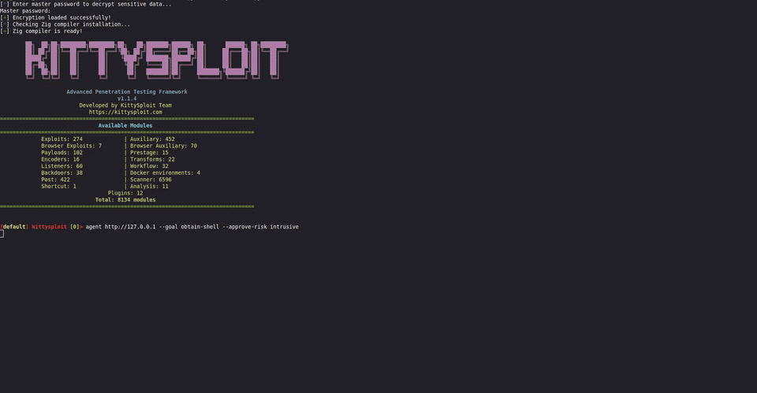

<div align="center">
  

# KittySploit

**Exploitation and post-exploitation framework — one console.**

Recon, scanning, **exploits**, interactive sessions, and **post-exploitation** across **60+ session connectors** (shell, browser, databases, cloud, IoT/ICS, and more).

[](https://www.python.org/)
[](LICENSE)
[](https://discord.gg/RNskjwSW5W)
[](https://github.com/SIA-IOTechnology/Kittysploit-framework)

**[Installation](#installation) · [Quick start](#quick-start) · [Full guide](USAGE.md) · [Website](https://kittysploit.com)**

</div>



## At a glance

| Step | What KittySploit does |
| --- | --- |
| **1. Find** | Web, network, cloud, and service scanners and recon |
| **2. Exploit** | Exploit modules, chains, and optional local-LLM agent |
| **3. Post-exploit** | **60+ session connectors** — loot, pivot, persistence, enumeration |

Everything stays in **one console**: modules, listeners, payloads, built-in C2, and reporting.

> Use only on targets you own or are **explicitly authorized** to test.

## Why KittySploit?

Typical stacks split the scanner, exploit framework, C2, and notes across different tools.

KittySploit brings them together: **exploit** to get a **session**, then run **post-exploitation** without switching apps.

**Post-exploitation connector examples:** Linux/Windows shell, browser (JS session), SSH, MySQL/PostgreSQL/Redis/MongoDB, SMB, FTP, Kubernetes, AWS/GCP/Azure, PHP webshell, WinRM, LDAP, BLE, MQTT, Modbus, BACnet, ONVIF, and more.

**Module scale (approximate):** thousands of scanners/auxiliary modules, **700+** exploits, **400+** post modules.

## Installation

### Linux and macOS

```bash
git clone https://github.com/SIA-IOTechnology/Kittysploit-framework.git
cd Kittysploit-framework
./install/install.sh
python3 kittyconsole.py
```

One-line install:

```bash
curl -fsSL https://raw.githubusercontent.com/SIA-IOTechnology/Kittysploit-framework/main/install/install-standalone.sh | bash
```

### Windows

```batch
git clone https://github.com/SIA-IOTechnology/Kittysploit-framework.git
cd Kittysploit-framework
install\install.bat
python kittyconsole.py
```

## Quick start

```text
kittysploit> doctor
kittysploit> search cve:2024 type:exploit
kittysploit> use exploits/multi/http/...
kittysploit> run

kittysploit> sessions -l
kittysploit> sessions -i 1
kittysploit> search type:post platform:windows
```

**Automated web mission (authorized lab):**

```bash
kittysploit> agent https://lab.local
```

Shell goal on an internal lab:

```bash
kittysploit> agent http://192.168.56.10 \
  --profile internal-lab \
  --goal obtain-shell \
  --approve-risk intrusive \
  --shell-hunter
```

Use `--plan-only` or `--dry-run` to preview without intrusive actions.

## Core features

- **Exploitation** — `search` / `use` / `run`, payloads, listeners, exploit queues
- **Sessions and C2** — shells, callbacks, pivots, multi-session management
- **Post-exploitation** — modules per session type (gather, manage, pivot, loot)
- **Agent (optional)** — local LLM (Ollama), mission profiles, scope controls
- **Automation** — CLI, API/RPC, and MCP for IDE or scripted workflows

Agent profiles, compound evidence, environment variables, and cookbooks are in **[USAGE.md](USAGE.md)**.

## Ecosystem

| Project | Purpose |
| --- | --- |
| [KittyProxy](https://github.com/SIA-IOTechnology/KittyProxy) | HTTP capture and analysis |
| [KittyCosmic](https://github.com/SIA-IOTechnology/KittyCosmic) | Graphical interface |
| [KittyOsint](https://github.com/SIA-IOTechnology/KittyOsint) | Visual OSINT |
| [KittyProtocol](https://github.com/SIA-IOTechnology/KittyProtocol) | Protocol analysis |
| [KittyV8Debugger](https://github.com/SIA-IOTechnology/KittyV8Debugger) | V8 debugging |

[Demo video](docs/screenshots/demo.mp4) · [Site and marketplace](https://kittysploit.com) · [Wiki](https://github.com/SIA-IOTechnology/Kittysploit-framework/wiki)

## Community

- [Discord](https://discord.gg/RNskjwSW5W)
- [Issues](https://github.com/SIA-IOTechnology/Kittysploit-framework/issues)
- [Liberapay](https://liberapay.com/KittySploit/donate)

The project is still evolving — validate in a lab before production engagements.

## Acknowledgments

Thanks to [Woody](https://github.com/v-Woody) for their contributions.

## License

Released under the [MIT License](LICENSE).